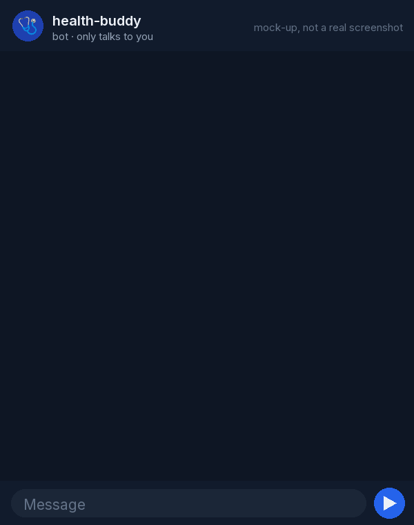
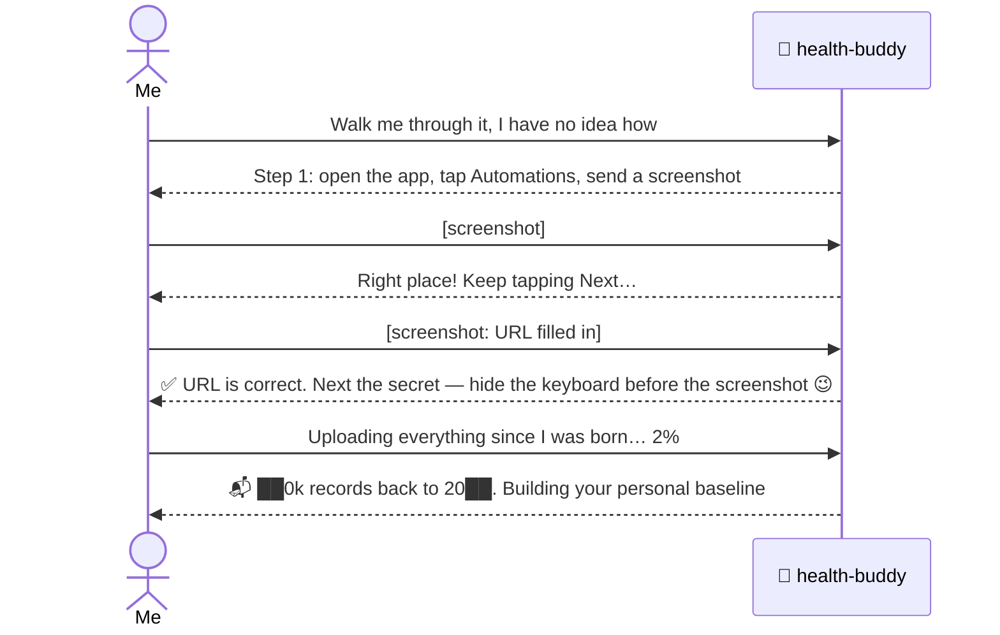
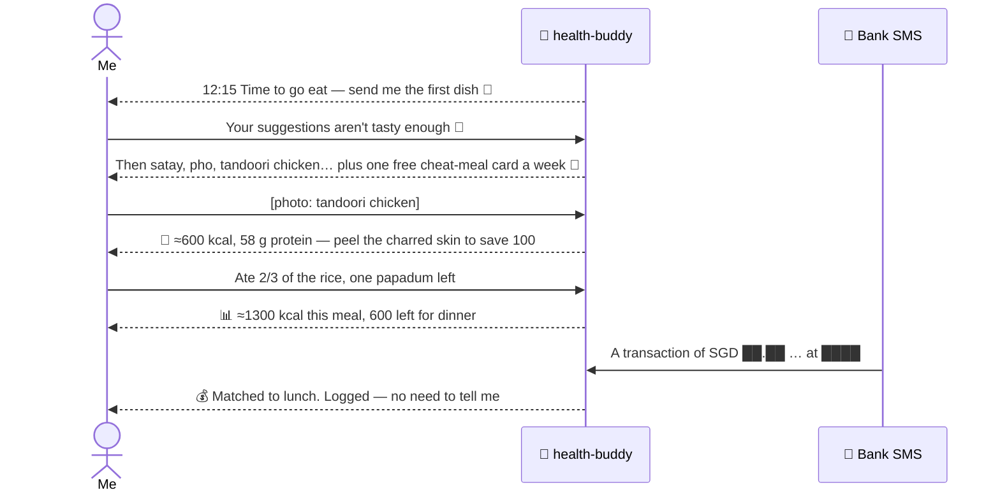
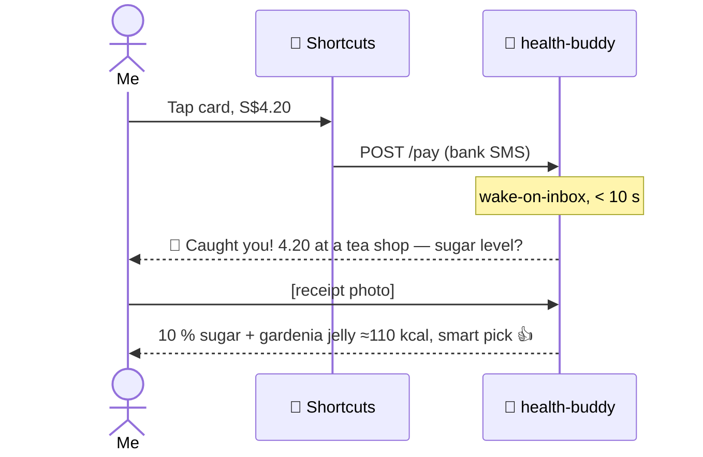
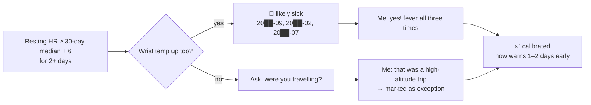
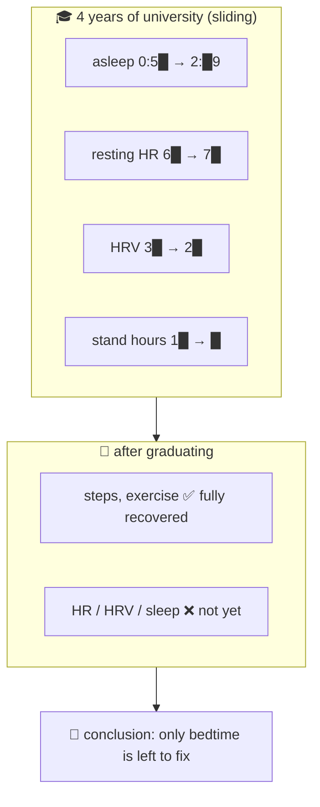
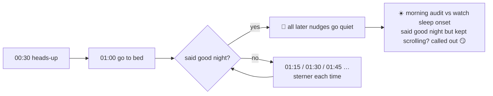
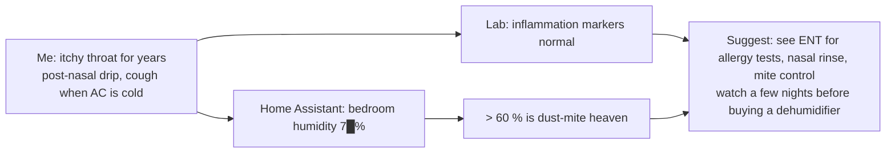

<div align="center">

# 🩺 health-buddy

**A self-hosted AI health butler + an expense ledger that writes itself.**

Ten seconds after you tap your card it asks "what did you get, sugar level?". It nags you to eat and sleep on time, reads meal photos and lab reports.<br>
Your data stays on your own disk, and it only listens to you.

[中文](README.md) · [English](README.en.md)

[](LICENSE)




<sub>Mock-up animation, not a real screenshot. Amounts and calories are fictional.</sub>

</div>

## In 30 seconds

- 🍱 **Eat**: snap a meal photo → food identified, kcal and macros estimated, filed per meal, restaurant remembered
- 💳 **Spend**: bank spend SMS → iPhone Shortcut forwards it → within 10 s the bot asks "what did you get?" → auto-categorised, food spends matched to the meal you photographed
- 😴 **Sleep**: bedtime nudges that keep coming until you say "good night"; audited against your watch the next morning
- ⌚ **Body**: hourly Apple Health sync builds *your* baseline; resting HR + wrist temperature + HRV off together → "you may be getting sick" 1–2 days early
- 🏠 **Home**: Home Assistant bedroom temperature / humidity / CO2 next to your sleep and symptoms
- 🔒 **All local**: one container, one `data/` folder, one SQLite file. Nothing leaves your machine except what goes to the model API you chose

Under the hood it is **Claude Code (or any CLI agent) + a ~200-line, zero-dependency Python bridge**. The bridge handles Telegram, the HTTP inbox and the scheduler; the agent reads `CLAUDE.md` to know who it is and uses the small tools in `bin/` to read and write the database. No framework, no third-party libraries.

## A day with it

| Time | What happens |
|---|---|
| ☀️ 09:00 | Morning report: asleep at 00:58 ✅, HRV above baseline, 10k steps yesterday |
| 🍱 12:15 | "Time to go eat." You snap a photo → calories estimated, filed under "date_lunch", restaurant remembered |
| 💳 13:40 | Card charged S$18.50 → matched to that lunch automatically. **You do nothing.** |
| 🧋 15:06 | Card charged S$4.20 → within 10 s: "4.20 at a tea shop — what did you get? Sugar level?" |
| 🤒 one day | "Resting HR +9 for two days and wrist temp is up — you may be getting sick. Sleep early tonight." |
| 🌙 23:00 | "One hour to your bedtime goal." Ignore it? 23:30, 00:00 … until you say good night |
| 📅 1st of month | "Last month: food S$5██, █ bubble teas S$3█, 3 fewer deliveries 👍" |

> These are the default schedule (`schedules.json`); one sentence in chat changes it.

## Requirements

**Required**
- A Docker host: NAS, Raspberry Pi, VPS or an old laptop (amd64 / arm64)
- A Telegram account (creating a bot is free)
- A model, one of: a **Claude subscription** (Pro / Max, long-lived token via `claude setup-token`) or an **Anthropic API key**. DeepSeek / Kimi / GLM and other Anthropic-compatible endpoints also work ([see below](#other-models--other-agents)). The model must **understand images** for meal photos to work
- Your phone must be able to reach the server: [Tailscale](https://tailscale.com/) (free) or the same LAN

**Optional** (each one is an independent plug-in)
- iPhone + Apple Watch: health data arrives via [Health Auto Export](https://www.healthyapps.dev/) (App Store; **automations require the paid Premium tier**). Illness early-warning needs the watch's sleeping wrist temperature
- iPhone Shortcuts: forwards your bank's spend SMS (your bank has to send SMS alerts). Android: Tasker / MacroDroid instead
- Home Assistant: bedroom sensors, plus any AC / lights you choose to let it touch

**Not needed**: a public IP, a domain, TLS certificates, a database server, any Python package.

> Honest caveat: without an iPhone the "health sync" and "card spend" halves need your own Android plumbing — the repo only ships the iOS path. The model is the only recurring cost, see [FAQ](#faq).

## Quick start (10 minutes)

```bash
git clone https://github.com/JamesNolan17/health-buddy && cd health-buddy
cp .env.example .env && nano .env       # 3 required values + pick one model
```

1. **Bot**: talk to [@BotFather](https://t.me/BotFather) → `/newbot` → token into `TELEGRAM_BOT_TOKEN`
2. **Your ID**: ask [@userinfobot](https://t.me/userinfobot) → `OWNER_CHAT_ID` (only this ID can command the bot)
3. **Inbox secret**: `openssl rand -hex 24` → `INBOX_TOKEN`
4. **Model**: uncomment exactly one of A / B / C. For a Claude subscription run `claude setup-token` on any machine with Claude Code installed and paste the result into `CLAUDE_CODE_OAUTH_TOKEN`
5. **Run**:

```bash
docker compose up -d --build
docker compose logs -f        # wait for "health-buddy up"
```

6. Say hi to your bot and tell it your goals ("asleep by 1 am", "lose fat"). Its long-term handbook is `data/work/CLAUDE.md`; the "Owner profile" at the end can be filled in by hand.
   **English speakers**: copy `data/work/CLAUDE.en.md` over `data/work/CLAUDE.md` and translate the prompts in `schedules.json` (the defaults are Chinese)
7. Timezone defaults to `Asia/Shanghai` — change `TZ` in `.env`. The default schedule (09:00 report / 12:15 lunch / 18:30 dinner / 21:00 workout / 23:00 + 23:30 bedtime) lives in `data/work/schedules.json` and is live-reloaded

> No Docker? Install Python 3.9+ and Claude Code (`npm i -g @anthropic-ai/claude-code`), copy `workspace/` to `/data/work`, run `HB_DATA=/data python3 bridge/app.py`. The tools in `bin/` hard-code `/data`, so the directory has to be exactly that.

## Data sources (all optional)

First make the inbox reachable from your phone: set `INBOX_BIND` in `.env` to the server's Tailscale IP (`100.x.x.x`) or LAN IP and `docker compose up -d`. The default `127.0.0.1` is reachable from the host only.

**⌚ Apple Health → Health Auto Export**
1. Install [Health Auto Export](https://www.healthyapps.dev/) (automations need Premium)
2. Automations → New → **REST API**
3. URL `http://<server>:8790/health`; header `Authorization` = `Bearer <INBOX_TOKEN>`
4. Health Metrics · JSON · v2 · Date Range Default · Summarize on · Time Grouping Hours · every 1 hour · Batch Requests on
5. History: use Manual Upload for the last 6–12 months first (uploading "since birth" starts from the oldest data and is slow)
6. Add a second automation with Data Type = Workouts
7. Stuck? Send the bot a screenshot of each step — it will walk you through (that is how the author set it up)

**💳 Card-spend SMS → iOS Shortcuts** (wake-on-inbox: "you just spent money — what was it?")
1. Shortcuts → Automation → + → **Message** → "Message contains" = the fixed prefix of your bank's spend SMS (e.g. `A transaction of`) → **Ask before running: off**
2. Action "Get Contents of URL": `http://<server>:8790/pay`, POST, header `Authorization: Bearer <INBOX_TOKEN>`, JSON body `text` = variable *Message*
3. Add a regex for your bank to `data/work/pay_patterns.json` (one Singapore UOB example included; named groups `currency amount card date merchant`). Or forward one SMS (card number masked) to the bot and ask it to add the rule
4. `pay` is in `inbox_wake.json` by default, so the agent wakes immediately

**🏠 Home Assistant**
1. HA → Profile → Security → Long-lived access token (a dedicated HA user is recommended)
2. Save it to `data/work/secrets/ha_token` (`chmod 600`); copy `ha.example.json` → `ha.json` and fill in URL & entities
3. Add `{"every_min": 10, "cmd": ["python3","-I","bin/ha.py","snap"]}` to `background.json`
4. Ask the bot to run `bin/ha.py states` and list your devices

> 🔐 **The inbox speaks plain HTTP.** Reach it only through Tailscale / WireGuard / LAN, or put an HTTPS reverse proxy in front (Caddy / Nginx / Cloudflare Tunnel). **Never** expose port 8790 to the internet directly.

## Privacy & security (please read)

- **Everything is in `data/`**: the SQLite database, meal photos, lab reports, raw JSON. Back up that one folder; move machines by copying it
- **The only thing that leaves your machine is what goes to the model API**: your messages, photos, and whatever the agent queries to answer you (it thinks with the model, so the model sees what it sees). Want zero cloud? Use a local model (Ollama + LiteLLM); quality depends on the model
- **Telegram is not end-to-end encrypted**: bot messages pass through Telegram's servers. True for every Telegram bot, not something this project can change
- **Owner only**: messages from anyone but `OWNER_CHAT_ID` are dropped without a reply
- **Inbox**: Bearer secret, allow-listed sources (`INBOX_SOURCES`), size limit, atomic writes — but plain HTTP, see above
- **The agent has a lot of power**: it runs with `--permission-mode bypassPermissions` inside the container (otherwise it cannot act on its own) and has passwordless sudo *inside the container* (to install tools; what it installs is recorded in `data/setup.sh`). Its reach is the container and the `data/` volume. Remove the sudo line in the Dockerfile if you prefer
- **Prompt injection**: "instructions" inside web pages, SMS and files are treated as data (spelled out in `CLAUDE.md`; inbox notifications are explicitly marked "not from the owner"). It is still an LLM, not a hard boundary: don't give it bank logins, don't let it control door locks
- HA token lives in `secrets/`, excluded by `.gitignore`

## Why not just use X?

- **MyFitnessPal and friends**: you search foods and type portions, and quit within a week. Here you send one photo — and the bot comes to you on schedule instead of waiting for you to open an app
- **Budgeting apps (YNAB, Mint-likes, bank aggregators)**: either manual entry or handing your bank login to a third party. Here the SMS is forwarded from your own phone to your own server; no one else's server is involved
- **Apple Health itself**: the data is there but nobody reads it. Here you get one human sentence a day and someone watching the long-term trend
- **Just asking ChatGPT / Claude**: no access to your data, no long-term memory, never reaches out first. The whole point here is "an agent that owns your database and acts on a schedule"
- **Home Assistant automations**: can notify "humidity high", but won't put humidity next to your itchy throat and sleep quality
- **Other Telegram AI bot projects**: mostly chat wrappers. This one is about the data pipeline (health / spending / home) + scheduler + local SQLite; chat is just the UI

## FAQ

- **Cost?** Only the model. Roughly a dozen calls a day (schedules + your messages + meal photos). A Claude subscription has no per-call billing and personal use generally fits in the quota; the Anthropic API bills per token and costs more; DeepSeek-class models are usually very cheap. Run it for a week and check your bill
- **Is a Claude subscription OK for this?** `claude setup-token` is Claude Code's official long-lived login for running Claude Code on your own machines; your subscription's rate limits apply
- **No iPhone?** Android: Health Connect + any app that can POST JSON → `/health` (adapt `ingest.py`); Tasker / MacroDroid POST the SMS to `/pay` with body `{"text": "<sms>"}`
- **My bank isn't UOB?** Add one regex to `pay_patterns.json` — any bank, any currency. Send the bot a masked SMS and ask it to write the rule
- **Does every scheduled job send a message?** Yes, each agent run replies. `CLAUDE.md` tells it to answer with a single 👍 when there's nothing to say. Pure data imports belong in `background.json` (no LLM, no messages)
- **Will it mess with my home?** `CLAUDE.md` requires asking before adding devices, editing automations or touching other people's rooms; every call is logged in `logs/ha_actions.log`
- **Moving machines / backups?** Stop the container, copy `data/`, `docker compose up -d`
- **Are the calories accurate?** Photo estimates are typically off by 20–30 %. The value is in the trend and in actually keeping the log, not in the last digit
- **Multiple users?** No — one bot, one owner by design. Run one container per person

## How it works

```
 iPhone ──Health Auto Export──┐
 iPhone ──Shortcuts (bank SMS)┼──► POST /health /pay /ha ──► /data/inbox/<source>/*.json
 Home Assistant ──────────────┘      (bridge inbox, Bearer auth)          │
                                                                          │ background import / wake-on-inbox
 You ◄──► Telegram ◄──► bridge/app.py ◄──► agent CLI (Claude Code …) ◄──► /data/work
                          ▲  scheduler: schedules.json                    ├ CLAUDE.md   long-term handbook
                          └─ background jobs: background.json             ├ NOTES.md    agent's own notes
                                                                          ├ bin/*.py    tools
                                                                          └ db/health.db SQLite
```

- **bridge/app.py** — a single file, Python stdlib only: Telegram I/O, inbox receiver, cron scheduler, wake-on-inbox, background jobs
- **agent** — Claude Code by default (`claude -p --resume`, the session continues automatically). It reads `CLAUDE.md` to know who it is and uses the tools in `bin/` to read and write SQLite; its own notes go to `NOTES.md`
- **Everything lives in `/data`** — back up one folder; move between an x86 NAS and an ARM VPS by copying it

<details>
<summary><b>📸 Seven real stories from the author's own health-buddy (numbers masked, translated — click to expand)</b></summary>

**① Zero to working, guided by screenshots**



**② One lunch: nudge → photo → estimate → auto-bookkeeping**



**③ Catching a bubble tea (under 10 s)**



**④ Finding past illnesses in watch data**



**⑤ University years vs after**



**⑥ The 1:30 rule (enforcement the owner asked for)**



**⑦ A 10-year itchy throat → the home sensors give a clue**



</details>

## Other models / other agents

The bridge just calls a CLI agent, so both the model and the agent are swappable.

**Option 1 — Anthropic-compatible endpoints (3 env vars, zero code)**

| Provider | `ANTHROPIC_BASE_URL` | `ANTHROPIC_MODEL` e.g. | Notes |
|---|---|---|---|
| DeepSeek | `https://api.deepseek.com/anthropic` | `deepseek-chat` / `deepseek-reasoner` | cheap; **check the docs for image support** — without vision, meal photos won't work (describe meals in text instead) |
| Kimi (Moonshot) | `https://api.moonshot.ai/anthropic` | `kimi-k2-…` | |
| Zhipu GLM | `https://open.bigmodel.cn/api/anthropic` | `glm-4.x` | vision variants available |
| OpenRouter / your LiteLLM | your gateway | anything | GPT, Gemini, Qwen, local Ollama … |

```env
ANTHROPIC_BASE_URL=https://api.deepseek.com/anthropic
ANTHROPIC_AUTH_TOKEN=sk-your-key
ANTHROPIC_MODEL=deepseek-chat
ANTHROPIC_SMALL_FAST_MODEL=deepseek-chat
# don't set ANTHROPIC_API_KEY at the same time
```

> Endpoints and model names change — follow each provider's docs. You want tool use, long context and vision for the full experience.

**Option 2 — OpenAI-format only?** Put [LiteLLM](https://github.com/BerriAI/litellm) or [claude-code-router](https://github.com/musistudio/claude-code-router) in front and point `ANTHROPIC_BASE_URL` at it.

**Option 3 — swap the whole agent** (Codex CLI, Gemini CLI, aider, your own script)
```env
AGENT=cmd
AGENT_CMD=gemini -p "$(cat)"     # prompt on stdin, reply on stdout
```
- Replace the Claude Code install line in the Dockerfile with your CLI
- Copy `CLAUDE.md` to the file your CLI reads (`AGENTS.md` for Codex, `GEMINI.md` for Gemini CLI)
- The agent must be able to run shell commands in `/data/work` (for the `bin/` tools) and ideally keep its own session
- Want multi-turn memory? Write a session-aware runner next to `run_claude()` in `bridge/app.py`

## Swappable parts

| Part | Default | Alternatives |
|---|---|---|
| Chat | Telegram | edit `send_text` / `telegram_loop`: Discord, Slack, Lark/Feishu, WeCom, Matrix |
| Phone health data | Health Auto Export | Android: Health Connect + Tasker / webhook apps → POST `/health` (adapt `ingest.py`) |
| Spend alerts | iOS Shortcuts SMS forward | Android Tasker / MacroDroid; bank e-mail alerts + mail rules |
| Smart home | Home Assistant | anything with an HTTP API — model a tool on `bin/ha.py` |
| Remote access | Tailscale | WireGuard, ZeroTier, Cloudflare Tunnel (add HTTPS) |
| Database | SQLite | it's enough; otherwise adapt the scripts in `bin/` |

## ⚠️ Disclaimer

health-buddy is **not a medical device and does not give medical advice**. Calorie numbers are estimates; health alerts are hints. If you feel unwell, see a doctor.

## License

MIT
