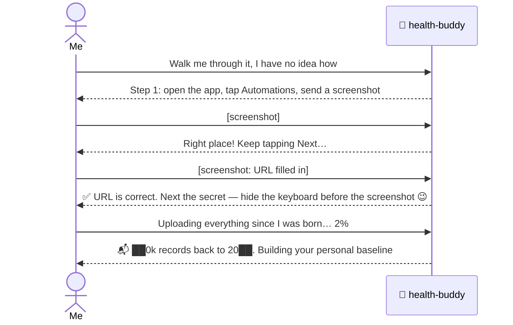
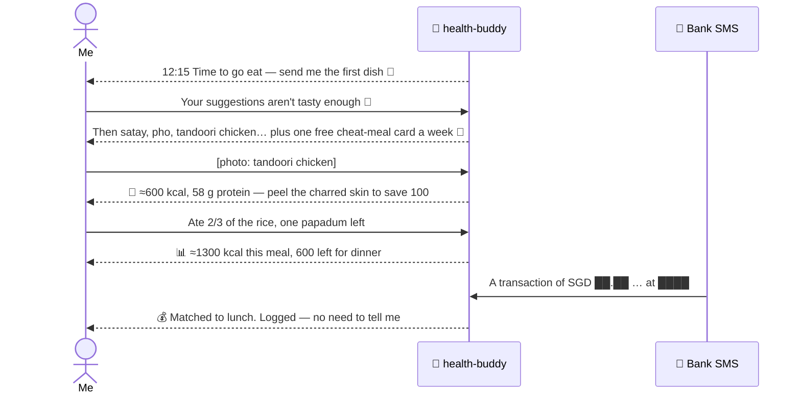
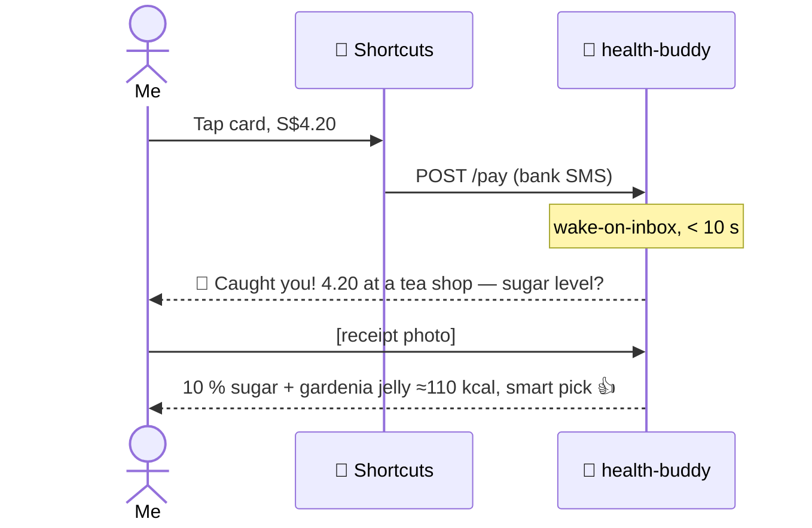
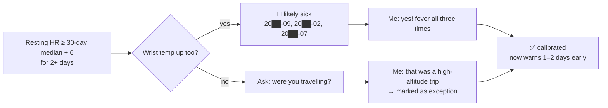
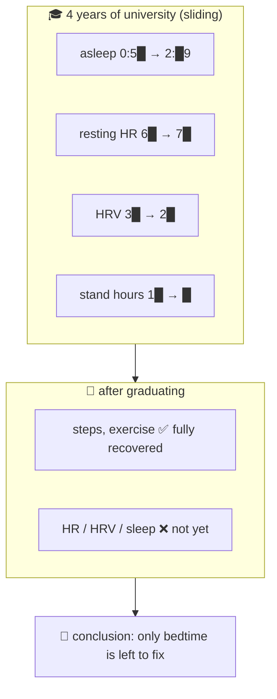
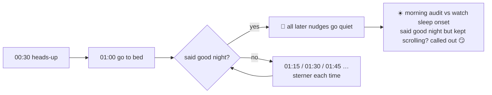
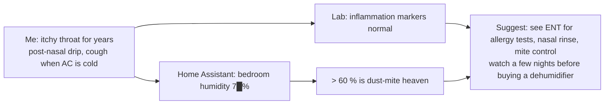

<div align="center">

# 🩺 health-buddy

**An AI health butler + self-writing expense ledger that lives on *your* server. It nags you to eat, reads your lab reports, watches your bedtime, logs every card spend for you, and warns you before the fever hits.**

[中文](README.md) · English

`Telegram` · `Apple Health` · `Home Assistant` · `SQLite` · `Claude Code / DeepSeek / Kimi / GLM …` · `amd64 + arm64`

</div>

---

### What it feels like

```
🤖 12:15  🍱 Time to head out for lunch! Aim to eat by 12:30, send me the first dish 📸
👤        [photo: tandoori chicken]
🤖        🍗 4 bone-in pieces ≈ 600 kcal, 58 g protein 💪 one fist of rice is enough
🤖 15:06  🧋 Caught you! S$4.20 at a bubble-tea shop. What did you get? Sugar level?
👤        [receipt photo]
🤖        Passion-fruit green tea, 10 % sugar + gardenia jelly ≈ 110 kcal — smart pick 👍
🤖 00:30  🌙 One hour until the "asleep by 1:30" rule. Start winding down, say good night
🤖 11:00  ☀️ Morning: asleep 00:58 ✅ 7.6 h, resting HR 6█ (your 30-day avg 6█)
```

### Who is it for?

- 🙋 **People who want to get healthier but never stick with it** — no willpower needed; it comes to you on time and is harder to snooze than an alarm
- 🧑‍💻 **Self-hosters with a NAS / Raspberry Pi / VPS** — one container, one folder, up in half an hour
- ⌚ **Apple Watch owners who never open the Health app** — years of data turned into one human sentence a day
- 💸 **Anyone who has tried budgeting apps and quit within a week** — card spends log themselves; you just answer "it was a bubble tea"
- 🏠 **Home Assistant users** — see bedroom temperature, humidity and CO2 next to your sleep and symptoms
- 🔒 **Privacy-minded people** — lab reports, heart rate and spending stay on your own disk, not in some app's cloud

### A day with it

| Time | What happens |
|---|---|
| ☀️ 11:00 | Morning report: asleep at 00:58 ✅, HRV above baseline, 10k steps yesterday |
| 🍱 12:15 | "Time to go eat." You snap a photo → calories estimated, filed under "2026-11-08_lunch", restaurant remembered |
| 💳 13:40 | Card charged S$18.50 → matched to that lunch automatically. **You do nothing.** |
| 🧋 15:06 | Card charged S$4.20 → within 10 s: "4.20 at a tea shop — what did you get? Sugar level?" |
| 🤒 one day | "Resting HR +9 for two days and wrist temp is up — you may be getting sick. Sleep early tonight." |
| 🌙 00:30 | "One hour to 1:30." Ignore it? 1:15, 1:30, 1:45 … until you say good night |
| 📅 1st of month | "Last month: food S$5██, █ bubble teas S$3█, 3 fewer deliveries 👍" |

### 💸 Never "try to keep a budget" again

Budgeting apps fail for one reason: **you have to log things yourself**. health-buddy flips it:

1. Bank spend SMS → iPhone Shortcut forwards it → logged in seconds (amount, merchant, card, date)
2. Auto-categorised (food / drinks / transport / shopping / subscriptions …); food spends are matched to the meal you photographed
3. Unmatched food spends? It asks what you had — and your food diary fills itself in
4. Ask anytime: "How much did I spend on bubble tea this month?" "What was my priciest meal last week?"

> Meal photos + card records together = a ledger that knows **what you ate, what it cost, and where**.

### Features

| | Feature | Needs |
|---|---|---|
| 💬 | Ask health questions on Telegram — it only listens to you | core |
| 🍱 | Meal photo → food, kcal, protein/carbs/fat, one folder per meal, restaurant & price | core (vision model) |
| 🏪 | "What should I eat?" → based on places you've been and today's calorie budget | core |
| 🧾 | Lab report PDF/photo → every value stored, flags highlighted, year-over-year | core |
| ⏰ | Lunch / dinner / workout / bedtime nudges, escalating bedtime chase until you say good night | core |
| ⌚ | Hourly Apple Health sync → personal baseline + daily morning report | Health Auto Export (iOS) |
| 🤒 | Illness early warning: resting HR + wrist temp + HRV together | Apple Watch |
| 💳 | Card-spend SMS → agent wakes within seconds → "you just spent 4.20 at a tea shop, what was it?" | iOS Shortcuts |
| 📒 | Automatic expense ledger: every spend categorised and matched to meals; ask "how much this month?" | iOS Shortcuts |
| 🏠 | Bedroom temperature / humidity / CO2 history; optional AC & light control | Home Assistant |

> The **minimal deployment** is just the first five rows: one container + one Telegram bot + one model API key. Everything else is an optional plug-in.

### 📸 Real conversations (sensitive details masked)

All from the author's first day with their own health-buddy (translated).

**① Zero to working, guided by screenshots**



**② One lunch: nudge → photo → estimate → auto-bookkeeping**



**③ Catching a bubble tea (under 10 s)**



**④ Finding past illnesses in watch data**



**⑤ University years vs after**



**⑥ The 1:30 rule (enforcement the owner asked for)**



**⑦ A 10-year itchy throat → the home sensors give a clue**



### Architecture

```
 iPhone ──Health Auto Export──┐
 iPhone ──Shortcuts (bank SMS)┼──► POST /health /pay /ha ──► /data/inbox/<source>/*.json
 Home Assistant ──────────────┘      (bridge inbox, Bearer auth)          │
                                                                          │ background import / wake-on-inbox
 You ◄──► Telegram ◄──► bridge/app.py ◄──► agent CLI (Claude Code …) ◄──► /data/work
                          ▲  scheduler: schedules.json                    ├ CLAUDE.md   long-term handbook
                          └─ background jobs: background.json             ├ NOTES.md    agent's own notes
                                                                          ├ bin/*.py    tools
                                                                          └ db/health.db SQLite
```

- **bridge/app.py** — a single file, Python stdlib only: Telegram I/O, inbox receiver, cron scheduler, wake-on-inbox, background jobs
- **agent** — Claude Code by default (`claude -p --resume`, the session continues automatically). It reads `CLAUDE.md` to know who it is and uses the tools in `bin/` to read and write the database
- **Everything lives in `/data`** — back up one folder; move between an x86 NAS and an ARM VPS by copying it

### Quick start (10 minutes)

**You need:** any Docker host (NAS / Raspberry Pi / VPS / old laptop), a Telegram account, a model API key.

```bash
git clone https://github.com/<you>/health-buddy && cd health-buddy
cp .env.example .env
```

1. **Bot**: talk to [@BotFather](https://t.me/BotFather) → `/newbot` → put the token in `TELEGRAM_BOT_TOKEN`
2. **Your ID**: ask [@userinfobot](https://t.me/userinfobot) → `OWNER_CHAT_ID` (only this ID can command it)
3. **Inbox secret**: `openssl rand -hex 24` → `INBOX_TOKEN`
4. **Model**: `ANTHROPIC_API_KEY`, or a Claude subscription via `claude setup-token` → `CLAUDE_CODE_OAUTH_TOKEN`. DeepSeek & friends: [see below](#other-models--other-agents)
5. **Run**:

```bash
docker compose up -d --build
docker compose logs -f        # wait for "health-buddy up"
```

6. Say hi to your bot. Fill in the "Owner profile" at the end of `data/work/CLAUDE.md` — or just tell it your goals in chat.
   English speakers: replace `data/work/CLAUDE.md` with `CLAUDE.en.md` and translate the prompts in `schedules.json`.

> No Docker? Install Python 3.9+ and Claude Code (`npm i -g @anthropic-ai/claude-code`), copy `workspace/` to `/data/work`, run `HB_DATA=/data python3 bridge/app.py`.

### Data sources (all optional)

**⌚ Apple Health → Health Auto Export**
1. Install [Health Auto Export](https://www.healthyapps.dev/) (automations need Premium)
2. Automations → New → **REST API**
3. URL `http://<server>:8790/health`; header `Authorization` = `Bearer <INBOX_TOKEN>`
4. Health Metrics · JSON · v2 · Date Range Default · Summarize on · Time Grouping Hours · every 1 hour · Batch Requests on
5. History: use Manual Upload for the last 6–12 months first (uploading "since birth" starts from the oldest data and is slow)
6. Add a second automation with Data Type = Workouts

**💳 Card-spend SMS → iOS Shortcuts** (wake-on-inbox)
1. Shortcuts → Automation → + → **Message** → "Message contains" = the fixed prefix of your bank's spend SMS (e.g. `A transaction of`) → **Ask before running: off**
2. Action "Get Contents of URL": `http://<server>:8790/pay`, POST, header `Authorization: Bearer <INBOX_TOKEN>`, JSON body `text` = variable *Message*
3. Add a regex for your bank to `workspace/pay_patterns.json` (UOB example included; named groups `currency amount card date merchant`). Or forward one SMS to your agent and ask it to add the rule
4. `pay` is in `inbox_wake.json` by default, so the agent wakes immediately

**🏠 Home Assistant**
1. HA → Profile → Security → Long-lived access token (a dedicated HA user is recommended)
2. Save it to `data/work/secrets/ha_token` (`chmod 600`); copy `ha.example.json` → `ha.json` and fill in URL & entities
3. Add `{"every_min": 10, "cmd": ["python3","-I","bin/ha.py","snap"]}` to `background.json`
4. Ask the agent to run `bin/ha.py states` and list your devices

> 🔐 **The inbox speaks plain HTTP.** Reach it only through [Tailscale](https://tailscale.com/) / WireGuard / LAN, or put an HTTPS reverse proxy in front (Caddy / Nginx / Cloudflare Tunnel). **Never** expose port 8790 to the internet directly.

### Other models / other agents

**Option 1 — Anthropic-compatible endpoints (3 env vars, zero code)**

| Provider | `ANTHROPIC_BASE_URL` | `ANTHROPIC_MODEL` e.g. | Notes |
|---|---|---|---|
| DeepSeek | `https://api.deepseek.com/anthropic` | `deepseek-chat` / `deepseek-reasoner` | cheap; **check the docs for image support** — without vision, meal photos won't work (describe meals in text instead) |
| Kimi (Moonshot) | `https://api.moonshot.ai/anthropic` | `kimi-k2-…` | |
| Zhipu GLM | `https://open.bigmodel.cn/api/anthropic` | `glm-4.x` | vision variants available |
| OpenRouter / your LiteLLM | your gateway | anything | GPT, Gemini, Qwen, local Ollama … |

```env
ANTHROPIC_BASE_URL=https://api.deepseek.com/anthropic
ANTHROPIC_AUTH_TOKEN=sk-your-key
ANTHROPIC_MODEL=deepseek-chat
ANTHROPIC_SMALL_FAST_MODEL=deepseek-chat
# don't set ANTHROPIC_API_KEY at the same time
```

> Endpoints and model names change — follow each provider's docs. You want tool use, long context and vision for the full experience.

**Option 2 — OpenAI-format only?** Put [LiteLLM](https://github.com/BerriAI/litellm) or [claude-code-router](https://github.com/musistudio/claude-code-router) in front and point `ANTHROPIC_BASE_URL` at it.

**Option 3 — swap the whole agent** (Codex CLI, Gemini CLI, aider, your own script)
```env
AGENT=cmd
AGENT_CMD=gemini -p "$(cat)"     # prompt on stdin, reply on stdout
```
- Replace the Claude Code install line in the Dockerfile with your CLI
- Copy `CLAUDE.md` to the file your CLI reads (`AGENTS.md` for Codex, `GEMINI.md` for Gemini CLI)
- The agent must be able to run shell commands in `/data/work` (for the `bin/` tools) and ideally keep its own session
- Want multi-turn memory? Write a session-aware runner next to `run_claude()` in `bridge/app.py`

### Swappable parts

| Part | Default | Alternatives |
|---|---|---|
| Chat | Telegram | edit `send_text` / `telegram_loop`: Discord, Slack, Lark/Feishu, WeCom, Matrix |
| Phone health data | Health Auto Export | Android: Health Connect + Tasker / webhook apps → POST `/health` (adapt `ingest.py`) |
| Spend alerts | iOS Shortcuts SMS forward | Android Tasker / MacroDroid; bank e-mail alerts + mail rules |
| Smart home | Home Assistant | anything with an HTTP API — model a tool on `bin/ha.py` |
| Remote access | Tailscale | WireGuard, ZeroTier, Cloudflare Tunnel (add HTTPS) |
| Database | SQLite | it's enough; otherwise adapt the scripts in `bin/` |

### Privacy & security

- All data stays in your `/data`; the project sends nothing to third parties **except your chosen model API**, which sees conversations and photos. Want zero cloud? Use a local model (Ollama + LiteLLM)
- Only `OWNER_CHAT_ID` can talk to it; "instructions" inside web pages, SMS and files are treated as data (spelled out in `CLAUDE.md`)
- Inbox: Bearer secret, allow-listed sources (`INBOX_SOURCES`), atomic writes, size limit
- The agent has passwordless sudo inside the container (so it can install tools and record them in `/data/setup.sh`). Remove that Dockerfile line if you prefer
- HA token lives in `secrets/`, excluded by `.gitignore`

### FAQ

- **Does every scheduled job send a message?** Yes, each agent run replies. `CLAUDE.md` tells it to answer with a single 👍 when there's nothing to say. Pure data imports belong in `background.json` (no LLM, no messages)
- **Cost?** Mostly the model: roughly a dozen calls a day. DeepSeek-class models are usually very cheap; the Claude API costs more; a Claude subscription has no per-call billing. Run it for a week and check your bill
- **Will it mess with my home?** `CLAUDE.md` requires asking before adding devices, editing automations or touching other people's rooms; every call is logged in `logs/ha_actions.log`
- **Moving machines?** Stop the container, copy `data/`, `docker compose up -d`

### ⚠️ Disclaimer

health-buddy is **not a medical device and does not give medical advice**. Calorie numbers are estimates; health alerts are hints. If you feel unwell, see a doctor.

### License

MIT
