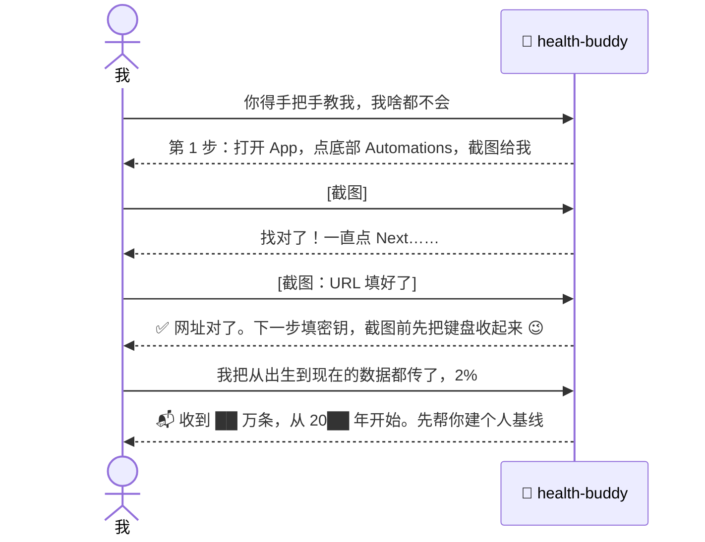
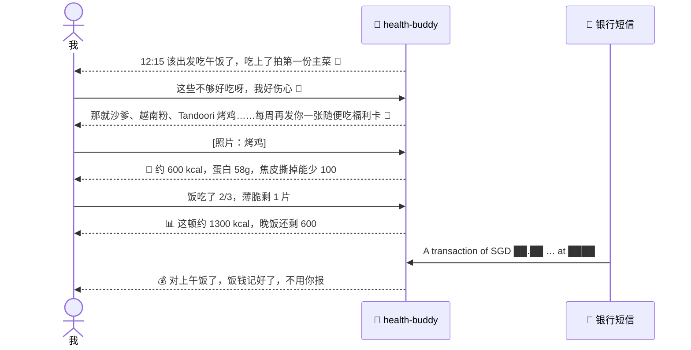
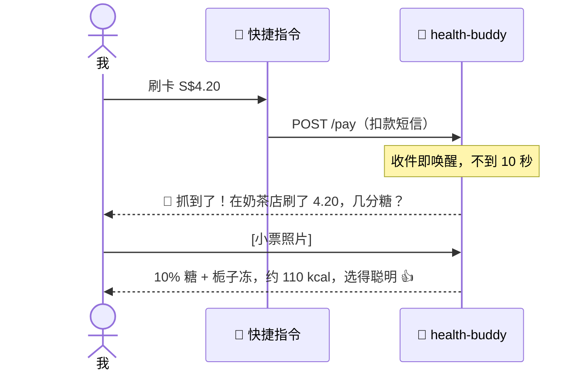
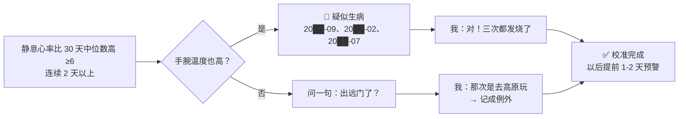
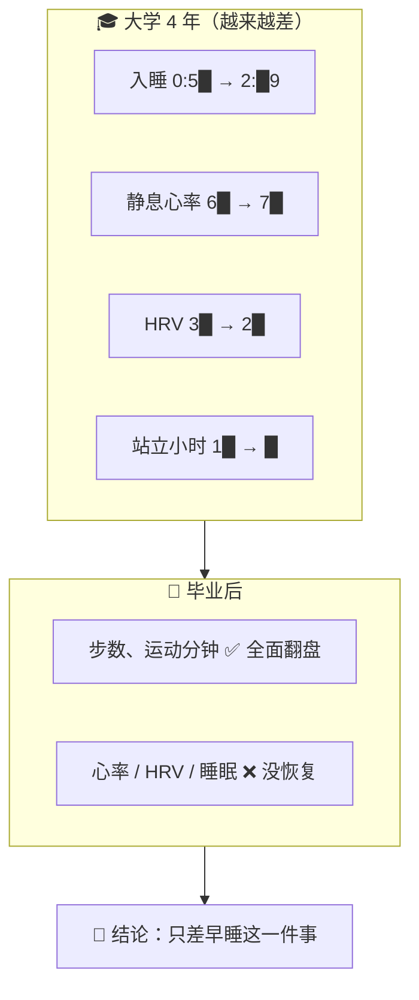
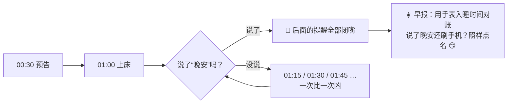
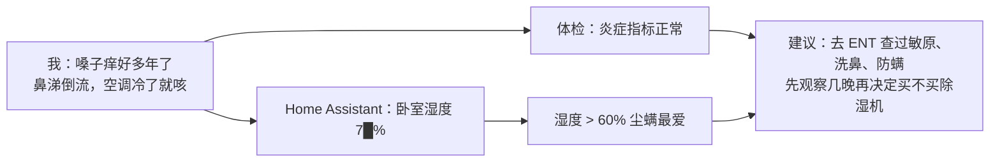

<div align="center">

# 🩺 health-buddy

**住在你自己服务器里的 AI 健康管家 + 自动记账本。它会催你吃饭、看懂体检报告、盯着你睡觉、替你记每一笔账，还会在你发烧之前提醒你。**

**An AI health butler + self-writing expense ledger on *your* server.**

[中文](#中文) · [English](README.en.md)

`Telegram` · `Apple Health` · `Home Assistant` · `SQLite` · `Claude Code / DeepSeek / Kimi / GLM …` · `amd64 + arm64`

</div>

---

## 中文

### 它长什么样

```
🤖 12:15  🍱 该出发吃午饭了！目标 12:30 吃上，到了拍第一份主菜给我 📸
👤        [照片：Tandoori 烤鸡]
🤖        🍗 4 块带骨约 600 大卡，蛋白 58g 💪 饭吃一拳头就够，酱汁别拌饭
🤖 15:06  🧋 抓到了！奶茶店刷了 S$4.20，点了啥？几分糖？
👤        [小票照片]
🤖        百香绿 10% 糖 + 栀子冻，约 110 大卡，选得聪明 👍 今天累计 1410 大卡
🤖 00:30  🌙 离“1:30 前睡着”铁律还有 1 小时，开始收尾，上床跟我说晚安
🤖 11:00  ☀️ 早报：入睡 00:58 ✅ 7.6 小时，静息心率 6█（低于你 30 天平均 6█）
```

### 适合谁？

- 🙋 **想变健康、但就是坚持不下来的人**：不用意志力，它到点就来找你，连环催，比闹钟难糊弄
- 🧑‍💻 **有 NAS / 树莓派 / VPS，喜欢折腾的人**：一个容器、一个文件夹，半小时搭好
- ⌚ **戴 Apple Watch，但从来不看“健康”App 的人**：几年的数据躺在手机里吃灰，它帮你变成每天一句人话
- 💸 **记过账、但从没坚持超过一周的人**：刷卡就自动入账，你只需要在它问的时候回一句“喝了杯奶茶”
- 🏠 **用 Home Assistant 的人**：卧室温湿度、CO2 和你的睡眠、嗓子痒放在一起看
- 🔒 **在乎隐私的人**：体检报告、心率、消费都在你自己的硬盘里，不上任何 App 的云

### 一天里的它

| 时间 | 发生了什么 |
|---|---|
| ☀️ 11:00 | 早报：昨晚 00:58 入睡 ✅，HRV 比平时高，昨天走了 1 万步 |
| 🍱 12:15 | “该出发吃午饭了。” 你拍了张照 → 自动算热量、存进“2026-11-08_午饭”、记下这家店 |
| 💳 13:40 | 刷卡 S$18.50 → 自动对上刚才那顿饭，饭钱记好了，**你什么都不用做** |
| 🧋 15:06 | 刷卡 S$4.20 → 10 秒内：“在奶茶店花了 4.2，喝了啥？几分糖？” |
| 🤒 某天 | “静息心率连续两天高了 9 下，手腕温度也高，可能要感冒了，今晚早点睡” |
| 🌙 00:30 | “离 1:30 还有 1 小时。” 你不理它？1:15、1:30、1:45……直到你说“晚安” |
| 📅 每月 1 号 | “上个月吃饭 S$5██，奶茶 █ 杯 S$3█，外卖比上月少 3 次 👍” |

### 💸 再也不用“坚持记账”了

传统记账 App 失败的原因只有一个：**要你自己记**。health-buddy 反过来：

1. 银行扣款短信 → iPhone 快捷指令自动转发 → 秒级入账（金额、商家、卡号、日期）
2. 自动分类（餐饮 / 饮料 / 交通 / 购物 / 订阅……），餐饮消费自动对上你拍的那顿饭
3. 没对上的餐饮消费，它会来问你吃了啥，顺便把饮食日记也补上了
4. 随时问：“这个月奶茶花了多少？”“上周吃饭最贵的是哪顿？”

> 吃饭照片 + 刷卡记录放在一起，你就有了一本**同时知道你吃了什么、花了多少钱、在哪吃的**账本。

### 能做什么

| | 功能 | 需要什么 |
|---|---|---|
| 💬 | Telegram 里随时问健康问题，只听主人一个人 | 必需 |
| 🍱 | 拍饭照 → 识别食物、估算热量和三大营养素、按顿归档、记录店铺和价格 | 必需（模型要能看图） |
| 🏪 | “不知道吃啥” → 按你吃过的店、今天的热量余额推荐 | 必需 |
| 🧾 | 体检报告 PDF/照片 → 逐项入库、标出异常、和往年对比 | 必需 |
| ⏰ | 午饭、晚饭、运动、睡觉按点督促，连环催睡，说“晚安”才停 | 必需 |
| ⌚ | Apple Health 每小时同步 → 个人基线 + 每日早报 | Health Auto Export（iOS） |
| 🤒 | 生病预警：静息心率 + 手腕温度 + HRV 一起异常 → 提前 1-2 天提醒 | Apple Watch |
| 💳 | 银行扣款短信 → 秒级唤醒 agent →“你刚在奶茶店花了 4.2，喝了啥？” | iOS 快捷指令 |
| 📒 | 自动记账：每笔消费自动分类、对上饭，随时问“这个月花了多少” | iOS 快捷指令 |
| 🏠 | 卧室温湿度、CO2 记录；可控制空调、灯（你授权的话） | Home Assistant |

> 最小部署只要前 5 行：一个容器 + 一个 Telegram 机器人 + 一个模型 API key。其他数据源都是可选插件。

### 📸 真实对话（关键信息已打码）

这些都来自作者和自己的 health-buddy 的第一天。

**① 从零到通：看截图，手把手带着设置**



**② 一顿午饭：催 → 拍 → 算 → 自动记账**



**③ 抓到一杯奶茶（10 秒内）**



**④ 从手表数据里认出你哪几次生病**



**⑤ 大学四年 vs 毕业后**



**⑥ 1:30 铁律（主人自己要求的“强制”）**



**⑦ 嗓子痒了 10 年 → 家里的传感器给了线索**



### 架构

```
 iPhone ──Health Auto Export──┐
 iPhone ──快捷指令(扣款短信)──┼──► POST /health /pay /ha ──► /data/inbox/<source>/*.json
 Home Assistant ──────────────┘        (bridge 收件口，Bearer 鉴权)        │
                                                                            │ 后台导入 / 收件即唤醒
 你 ◄──► Telegram ◄──► bridge/app.py ◄──► agent CLI（Claude Code 等） ◄──► /data/work
                         ▲   定时器 schedules.json                         ├ CLAUDE.md  长期说明书
                         └── 后台任务 background.json                      ├ NOTES.md   agent 自己的笔记
                                                                            ├ bin/*.py   工具
                                                                            └ db/health.db  SQLite
```

- **bridge/app.py**：一个文件、只用 Python 标准库。Telegram 收发、收件口、cron 定时器、收件即唤醒、后台任务都在这里
- **agent**：默认 Claude Code（`claude -p --resume`，自动续上会话）。它读 `CLAUDE.md` 知道自己是谁、该怎么做，自己用 `bin/` 里的工具读写数据库
- **一切都在 `/data`**：备份这一个文件夹就够了；换机器（x86 NAS ↔ ARM VPS）直接拷过去

### 快速开始（10 分钟）

**你需要：** 一台能跑 Docker 的机器（NAS / 树莓派 / VPS / 旧电脑）、一个 Telegram 账号、一个模型 API key。

```bash
git clone https://github.com/<you>/health-buddy && cd health-buddy
cp .env.example .env
```

1. **建机器人**：Telegram 找 [@BotFather](https://t.me/BotFather) → `/newbot` → 把 token 填进 `TELEGRAM_BOT_TOKEN`
2. **拿到你的 ID**：找 [@userinfobot](https://t.me/userinfobot)，数字填进 `OWNER_CHAT_ID`（只有这个 ID 能指挥它）
3. **收件口密钥**：`openssl rand -hex 24` 填进 `INBOX_TOKEN`
4. **模型**：填 `ANTHROPIC_API_KEY`，或者用 Claude 订阅：在任意电脑上 `claude setup-token`，填 `CLAUDE_CODE_OAUTH_TOKEN`。想用 DeepSeek 等见[下文](#换模型--换-agent)
5. **启动**：

```bash
docker compose up -d --build
docker compose logs -f        # 看到 health-buddy up 就好了
```

6. 去 Telegram 给你的机器人发一句“你好”。第一次建议先改 `data/work/CLAUDE.md` 最后的「主人档案」，或者直接在聊天里告诉它你的目标

> 不想用 Docker？装好 Python 3.9+ 和 Claude Code（`npm i -g @anthropic-ai/claude-code`），把 `workspace/` 拷到 `/data/work`，再运行 `HB_DATA=/data python3 bridge/app.py` 就行。

### 接数据源（都可选）

**⌚ Apple Health → Health Auto Export**
1. App Store 装 [Health Auto Export](https://www.healthyapps.dev/)，自动同步要买 Premium
2. Automations → 新建 → 类型选 **REST API**
3. URL：`http://<你的服务器>:8790/health`；Header：`Authorization` = `Bearer <INBOX_TOKEN>`
4. Data Type：Health Metrics；Format：JSON；Version：v2；Date Range：Default；Summarize：开；Time Grouping：Hours；Sync：每 1 小时；Batch Requests：开
5. 想要历史数据：Manual Upload 选最近 6-12 个月先传（从最老的开始传很慢）
6. 再建一个 Data Type = Workouts 的自动化，健身记录也能传过来

**💳 扣款短信 → iOS 快捷指令**（秒级唤醒，“你刚花了钱，吃了啥？”）
1. 快捷指令 → 自动化 → + → **信息** → “信息包含”填你银行扣款短信的固定开头（例如 `A transaction of`）→ **运行前确认：关**
2. 动作：「获取 URL 内容」→ URL `http://<服务器>:8790/pay`，方法 POST，Header `Authorization: Bearer <INBOX_TOKEN>`，请求体 JSON：`text` = 变量「信息」
3. 在 `workspace/pay_patterns.json` 加你银行的正则（已带 UOB 示例；命名分组 `currency amount card date merchant`）。不会写正则？把一条短信发给你的 agent，让它帮你加
4. `inbox_wake.json` 里默认有 `pay`，收到就立刻叫醒 agent

**🏠 Home Assistant**
1. HA → 个人资料 → 安全 → 创建「长期访问令牌」（建议给 agent 单独建一个用户）
2. 令牌放进 `data/work/secrets/ha_token`（`chmod 600`），复制 `ha.example.json` 为 `ha.json` 填好 URL 和实体
3. `background.json` 加一行 `{"every_min": 10, "cmd": ["python3","-I","bin/ha.py","snap"]}` 就会每 10 分钟记一次卧室环境
4. 让 agent 运行 `bin/ha.py states` 摸底，它会把设备列给你看

> 🔐 **收件口是 HTTP。** 请只通过 [Tailscale](https://tailscale.com/) / WireGuard / 内网访问，或者在前面放一个带 HTTPS 的反向代理（Caddy / Nginx / Cloudflare Tunnel）。**不要**把 8790 端口直接暴露到公网。

### 换模型 / 换 agent

bridge 只是调用一个命令行 agent，所以模型和 agent 都能换。

**方式 1：Anthropic 兼容接口（改 3 个环境变量，什么代码都不用动）**

Claude Code 可以接任何兼容 Anthropic Messages API 的服务。在 `.env` 里：

| 模型 | `ANTHROPIC_BASE_URL` | `ANTHROPIC_MODEL` 示例 | 备注 |
|---|---|---|---|
| DeepSeek | `https://api.deepseek.com/anthropic` | `deepseek-chat` / `deepseek-reasoner` | 便宜；**看图能力以官方文档为准**，不能看图时饭照识别会失效，可以改成文字描述 |
| Kimi（Moonshot） | `https://api.moonshot.cn/anthropic` | `kimi-k2-…` | 国内直连 |
| 智谱 GLM | `https://open.bigmodel.cn/api/anthropic` | `glm-4.x` | 有视觉版本 |
| OpenRouter / 自建 LiteLLM | 你的网关地址 | 任意 | 可以接 GPT、Gemini、Qwen、本地 Ollama |

```env
ANTHROPIC_BASE_URL=https://api.deepseek.com/anthropic
ANTHROPIC_AUTH_TOKEN=sk-你的key
ANTHROPIC_MODEL=deepseek-chat
ANTHROPIC_SMALL_FAST_MODEL=deepseek-chat
# 别同时设置 ANTHROPIC_API_KEY
```

> 各家接口地址和模型名会变，以官方文档为准。工具调用、长上下文、看图这三样都要支持，体验才完整。

**方式 2：只有 OpenAI 格式接口？** 在前面放一个转换网关，比如 [LiteLLM](https://github.com/BerriAI/litellm) 或 [claude-code-router](https://github.com/musistudio/claude-code-router)，把 `ANTHROPIC_BASE_URL` 指向它。

**方式 3：换掉整个 agent**（Codex CLI、Gemini CLI、aider，或者你自己写的脚本）
```env
AGENT=cmd
AGENT_CMD=gemini -p "$(cat)"     # prompt 从 stdin 进，回复从 stdout 出
```
- 在 Dockerfile 里把 `npm install -g @anthropic-ai/claude-code` 换成对应 CLI 的安装命令
- 把 `CLAUDE.md` 复制成那个 CLI 读的文件名（Codex：`AGENTS.md`；Gemini CLI：`GEMINI.md`）
- 要求：能在 `/data/work` 里执行 shell 命令（不然用不了 `bin/` 工具），最好能自己记住会话
- 想要多轮记忆：在 `bridge/app.py` 里仿照 `run_claude()` 写一个带会话 ID 的函数

### 可替换的部分

| 组件 | 默认 | 可以换成 |
|---|---|---|
| 聊天 | Telegram | 改 `bridge/app.py` 的 `send_text` / `telegram_loop`：飞书、Discord、Slack、企业微信机器人，或者 Matrix |
| 手机健康数据 | Health Auto Export | Android：Health Connect + Tasker / HC Webhook 类 App，POST 到 `/health`（需要改 `ingest.py` 的解析） |
| 扣款通知 | iOS 快捷指令转短信 | Android：Tasker / MacroDroid 转发短信或通知；银行邮件提醒 → 邮件规则转发 |
| 家居 | Home Assistant | 任何有 HTTP API 的平台，照着 `bin/ha.py` 写一个小工具 |
| 内网穿透 | Tailscale | WireGuard、ZeroTier、Cloudflare Tunnel（记得加 HTTPS） |
| 数据库 | SQLite | 够用了。真要换，改 `bin/` 里的几个脚本 |

### 隐私与安全

- 数据全在你自己的 `/data` 里，项目本身不往任何第三方发数据。**唯一的例外是你选的模型 API**：对话和照片会发给模型提供方，介意的话就用本地模型（Ollama + LiteLLM）
- 只有 `OWNER_CHAT_ID` 能和它说话；网页、短信、文件里的“指令”一律当成数据（写在 `CLAUDE.md` 里）
- 收件口用 Bearer 密钥，只认 `INBOX_SOURCES` 里列出的来源，原子写入，有大小上限
- agent 在容器里有免密 sudo（方便它自己装工具，装了什么会写进 `/data/setup.sh`）。不想给就删掉 Dockerfile 里那一行
- HA 令牌放在 `secrets/`，`.gitignore` 已经排除了

### 常见问题

- **定时任务每次都会发消息？** 是的，agent 每次运行都会回复。没事可说时 `CLAUDE.md` 让它只回一个 👍。纯数据导入放进 `background.json`，不经过 LLM、不发消息
- **花多少钱？** 主要看模型。每天大约十几次调用（定时任务 + 你的消息 + 饭照）。DeepSeek 这类模型通常很便宜，Claude API 按量计费会贵一些，用 Claude 订阅则不另外按次收费。先跑一周看看账单再说
- **它会乱改我的家居吗？** `CLAUDE.md` 规定：加设备、改自动化、动别人房间的设备之前必须先问你；所有调用都记在 `logs/ha_actions.log`
- **换机器？** 停容器，把 `data/` 整个拷过去，`docker compose up -d`

### ⚠️ 免责声明

health-buddy **不是医疗器械，也不提供医疗建议**。它给出的热量是估算，健康提醒只是参考。身体不舒服请去看医生。

### License

MIT
