<div align="center">

# 🩺💰 healthy-wealthy · 又健又富

**健康 + 钱包，一个本地运行的 AI 管家全管了。**

装在你家任意一台电脑、NAS 或云服务器上，数据只留在你自己手里。<br>
拍张饭照就知道热量和营养，每一笔刷卡自动记账，到点催你睡觉，看得懂体检报告和手表数据。

[中文](README.md) · [English](README.en.md)

[](LICENSE)


<table>
<tr>
<td align="center" width="50%">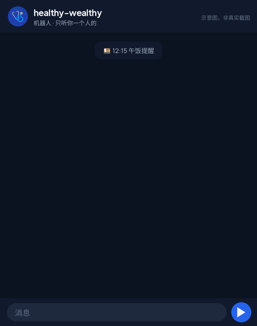<br><sub>🍱 拍饭照 → 热量、营养、下一顿建议</sub></td>
<td align="center" width="50%">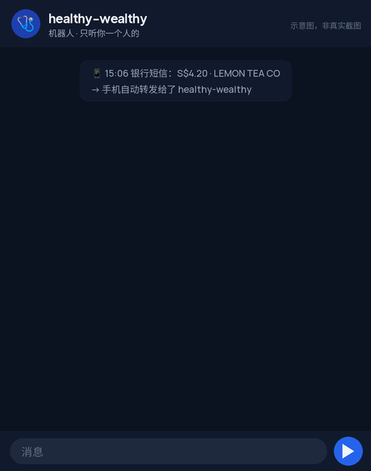<br><sub>💳 刷卡自动记账 → 晚间账单 → 信用卡提醒</sub></td>
</tr>
<tr>
<td align="center">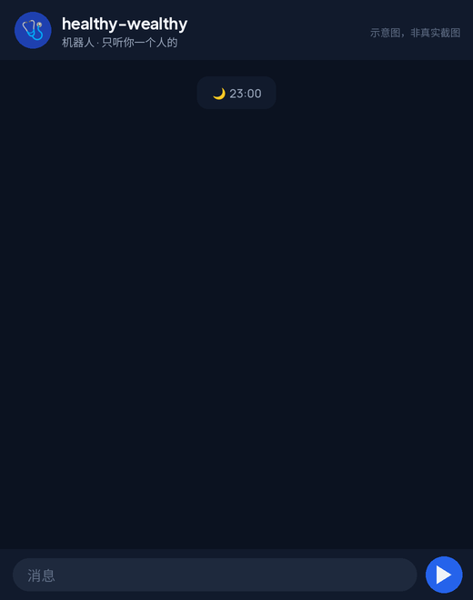<br><sub>😴 催睡到说“晚安” → 早上用手表对账</sub></td>
<td align="center">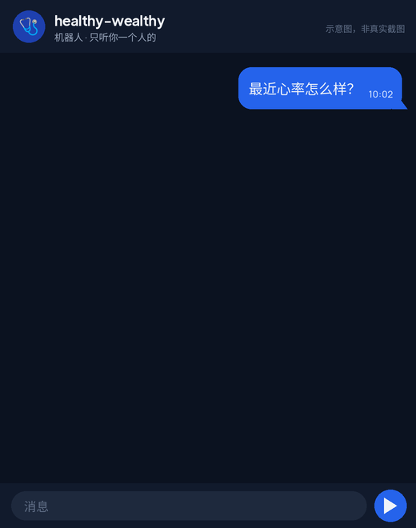<br><sub>📈 手表趋势图 → 生病前 1-2 天预警</sub></td>
</tr>
<tr>
<td align="center" colspan="2">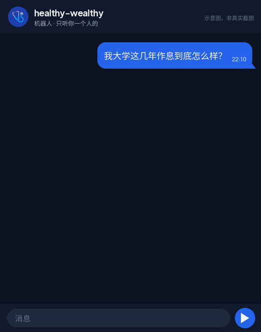<br><sub>🎓 几年的手表数据 → 大学四年越睡越晚，一张图看明白</sub></td>
</tr>
</table>

<sub>以上都是示意动画（APNG），不是真实截图；饭照是作者自己的午饭，金额和卡号是虚构的。</sub>

</div>

## 30 秒看懂

- 🍱 **吃**：拍张饭照 → 认出食物、估算份量，给出热量和蛋白/碳水/脂肪，顺手点评一句、建议下一顿吃啥；每顿归档，今天吃了多少随时知道
- 💸 **花（自动记账）**：银行扣款短信由手机自动转发给它 → 每一笔自动分类入账，还知道是哪张卡刷的；吃饭的钱自动对上你拍的那顿饭，打车、超市、订阅这些顺手记下，你什么都不用填
- 🏪 **熟店不用解释**：它记得你常去的店和常点的东西，再刷同一家只问一句“老样子？”
- 👀 **吃饭花钱有人盯**：每晚一份小账单——今天吃饭花了平时的 1.6 倍、第 2 份甜点了，会被温和点名；每月 1 号按分类总结
- 💳 **信用卡最低消费提醒**：哪张卡每月要刷满多少才有返现或里程，月底前它算好“还差多少、剩几天”来提醒
- 😴 **睡**：到点催你上床，不说“晚安”就一直催；第二天用手表的入睡时间对账
- ⌚ **身体**：Apple Watch 的数据每小时同步过来，慢慢摸清你平时的水平；静息心率、手腕温度、心率变异性一起不对劲 → 提前 1-2 天说“你可能要感冒了”
- 📈 **要图就画图**：“画一下这个月吃饭和其他花销”“最近 30 天静息心率的趋势” → 直接发你一张图
- 🏠 **家**：卧室的温度、湿度、CO2（来自 Home Assistant）和你的睡眠、嗓子痒放在一起看
- 🔒 **数据在你手里**：所有记录都存在你自己机器上的一个文件夹里，备份就是拷贝它；除了你选的 AI 模型服务，不会发到任何地方

它靠一个 AI 模型（默认 Claude）来理解你的话和照片，再用几个小工具把结果记进你自己的数据库。你只需要在 Telegram 里和它聊天。技术细节见[它是怎么工作的](#它是怎么工作的)。

## 所有数据都在一个本地数据库里，后面随你发挥

它记下的每一样东西——饭（照片、热量、三大营养素、在哪吃、花了多少）、每一笔消费（商家、卡、分类）、睡眠、手表指标、体检报告、卧室环境——都整整齐齐放在**同一个 SQLite 文件**里：`data/work/db/health.db`。一个文件，拷走就是备份，任何工具都能打开。

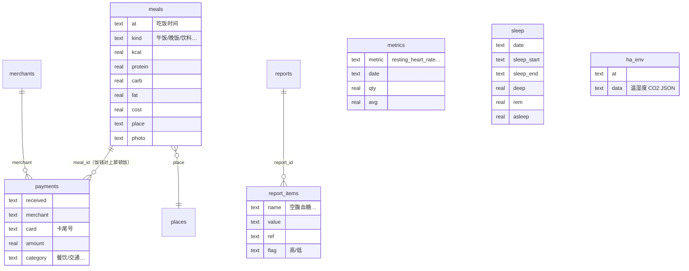

| 表 | 里面是什么 | 谁写进去 |
|---|---|---|
| `meals` | 每顿饭：时间、类型、食物描述、热量、蛋白/碳水/脂肪、吃了几成、花费、店名、照片路径 | agent（`hdb.py meal`） |
| `places` | 吃过的店：区域、点过什么、健康选择、避雷、价格、喜不喜欢 | agent |
| `payments` | 每一笔扣款：时间、商家、金额、币种、卡尾号、分类、对上的那顿饭 | `pay_ingest.py` + agent 打分类 |
| `merchants` | 商家记忆：分类、常点的东西、来过几次 | `spend.py cat / learn` |
| `metrics` | Apple Health 的所有指标：静息心率、HRV、步数、手腕温度……按小时/天 | `ingest.py` |
| `sleep` | 每晚睡眠：入睡/起床时间、深睡/核心/REM/清醒时长 | `ingest.py` |
| `hae_workouts` / `workouts` | 手表里的运动记录 / 你口头报的训练 | `ingest.py` / agent |
| `reports` + `report_items` | 体检报告原件 + 逐项指标（数值、单位、参考范围、高/低） | agent |
| `sleep_log` / `symptoms` | 你说的上床时间、症状（嗓子痒、头痛……） | agent |
| `ha_env` | 卧室温度、湿度、CO2、PM2.5、空调/灯状态，每 10 分钟一条 | `ha.py snap` |

有了这一个文件，你能做的远不止聊天：

- **跨健康和钱问任何问题**：“吃得越贵越健康吗？”“睡得晚的第二天是不是更爱点外卖？”“奶茶和静息心率有关系吗？”——agent 自己写 SQL 查，你只管问
- **自己看数据**：`sqlite3 data/work/db/health.db`，或者用 [DB Browser for SQLite](https://sqlitebrowser.org/) 点开
- **导出**：`sqlite3 -csv data/work/db/health.db "select * from meals" > meals.csv` → Excel / Numbers / Notion
- **做看板**：Grafana（SQLite 数据源插件）、Metabase、或者一段 pandas + matplotlib
- **训练你自己的模型**：几年的饮食、睡眠、心率、消费都是对齐到时间轴的表格数据

## 一天里的它

| 时间 | 发生了什么 |
|---|---|
| ☀️ 09:00 | 早报：昨晚 00:58 入睡 ✅，HRV 比平时高，昨天走了 1 万步 |
| 🍱 12:15 | “该出发吃午饭了。” 你拍了张照 → 自动算热量、存进“日期_午饭”文件夹、记下这家店 |
| 💳 13:40 | 刷卡 S$18.50 → 自动对上刚才那顿饭，饭钱记好了，**你什么都不用做** |
| 🧋 15:06 | 刷卡 S$4.20 → 10 秒内：“又是柠檬茶铺，老样子少糖？” 你回个“嗯”，就记好了 |
| 🧾 21:30 | 晚间账单：“今天吃饭 S$46，是平时的 1.6 倍，奶茶第 2 杯了 👀 打车 S$32 已记” |
| 💳 24 号 | “尾号 0000 的返现卡本月还差 S$85 到最低消费，剩 6 天，大额消费记得刷它” |
| 🤒 某天 | “静息心率连续两天高了 9 下，手腕温度也高，可能要感冒了，今晚早点睡” |
| 🌙 23:00 | “离睡觉目标还有 1 小时。” 你不理它？23:30、00:00……直到你说“晚安” |
| 📅 每月 1 号 | “上个月吃饭 S$560，奶茶 9 杯 S$38，外卖比上月少 3 次 👍” |

> 以上时间是默认时间表（`schedules.json`），在聊天里一句话就能让它改。

## 你需要什么

**必须**
- 一台能跑 Docker 的机器：NAS、树莓派、VPS、旧电脑都行（amd64 / arm64）
- 一个 Telegram 账号（建机器人免费）
- 一个模型，二选一：**Claude 订阅**（Pro / Max，用 `claude setup-token` 拿长期令牌）或 **Anthropic API key**。也能换成 DeepSeek / Kimi / GLM 等兼容 Anthropic 接口的模型（[见下文](#换模型--换-agent)）。模型要**能看图**，饭照识别才有用
- 手机能访问到服务器：推荐 [Tailscale](https://tailscale.com/)（免费），或者在同一个内网

**可选**（每一项都是独立插件，不装也能用）
- iPhone + Apple Watch：健康数据靠 [Health Auto Export](https://www.healthyapps.dev/) 推送（App Store，**自动同步需要 Premium 付费**）；生病预警需要手表的睡眠手腕温度
- iPhone 快捷指令：转发银行扣款短信（你的银行得发短信通知）。Android 可以用 Tasker / MacroDroid 替代
- Home Assistant：卧室传感器，以及你愿意授权的空调、灯

**不需要**：公网 IP、域名、HTTPS 证书、数据库服务、任何 Python 第三方库。

> 坦白说：没有 iPhone 的话，“健康同步”和“刷卡记账”这两块要自己找 Android 替代方案（项目只带了 iOS 的路径）。模型是唯一的持续成本，见[常见问题](#常见问题)。

## 快速开始（10 分钟）

```bash
git clone https://github.com/JamesNolan17/healthy-wealthy && cd healthy-wealthy
cp .env.example .env && nano .env       # 填 3 个必填项，再选一个模型
```

1. **建机器人**：Telegram 找 [@BotFather](https://t.me/BotFather) → `/newbot` → token 填进 `TELEGRAM_BOT_TOKEN`
2. **拿到你的 ID**：找 [@userinfobot](https://t.me/userinfobot)，数字填进 `OWNER_CHAT_ID`（只有这个 ID 能指挥它）
3. **收件口密钥**：`openssl rand -hex 24` 填进 `INBOX_TOKEN`
4. **模型**：A / B / C 三选一，把选中那组前面的 `#` 去掉。Claude 订阅：在任意装了 Claude Code 的电脑上运行 `claude setup-token`，把输出贴进 `CLAUDE_CODE_OAUTH_TOKEN`
5. **启动**：

```bash
docker compose up -d --build
docker compose logs -f        # 看到 "healthy-wealthy up" 就好了
```

6. 去 Telegram 给机器人发一句“你好”，然后直接告诉它你的目标（“我想 1 点前睡”“帮我减脂”）。它的长期说明书在 `data/work/CLAUDE.md`，最后有「主人档案」可以手填
7. 时区默认 `Asia/Shanghai`，在 `.env` 里改 `TZ`；默认时间表（9:00 早报 / 12:15 午饭 / 18:30 晚饭 / 21:00 运动 / 23:00、23:30 催睡）在 `data/work/schedules.json`，改完即生效

> 不想用 Docker？装好 Python 3.9+ 和 Claude Code（`npm i -g @anthropic-ai/claude-code`），把 `workspace/` 拷到 `/data/work`，再运行 `HB_DATA=/data python3 bridge/app.py`。注意 `bin/` 里的工具写死了 `/data` 路径，所以目录必须是 `/data`。

## 接数据源（都可选）

先让手机能访问到收件口：`.env` 里把 `INBOX_BIND` 改成服务器的 Tailscale IP（`100.x.x.x`）或内网 IP，`docker compose up -d` 重启。默认 `127.0.0.1` 只有本机能访问。

**⌚ Apple Health → Health Auto Export**
1. App Store 装 [Health Auto Export](https://www.healthyapps.dev/)（自动同步要 Premium）
2. Automations → 新建 → 类型选 **REST API**
3. URL：`http://<服务器>:8790/health`；Header：`Authorization` = `Bearer <INBOX_TOKEN>`
4. Data Type：Health Metrics；Format：JSON；Version：v2；Date Range：Default；Summarize：开；Time Grouping：Hours；Sync：每 1 小时；Batch Requests：开
5. 想要历史数据：Manual Upload 先传最近 6-12 个月（从最老的开始传很慢）
6. 再建一个 Data Type = Workouts 的自动化，健身记录也能传过来
7. 不会设置？把每一步的截图发给机器人，它会带着你点（作者就是这么装的）

**💳 扣款短信 → iOS 快捷指令**（秒级唤醒：“你刚花了钱，吃了啥？”）
1. 快捷指令 → 自动化 → + → **信息** → “信息包含”填你银行扣款短信的固定开头（例如 `A transaction of`）→ **运行前确认：关**
2. 动作「获取 URL 内容」→ URL `http://<服务器>:8790/pay`，方法 POST，Header `Authorization: Bearer <INBOX_TOKEN>`，请求体 JSON：`text` = 变量「信息」
3. 在 `data/work/pay_patterns.json` 加你银行的正则（已带一个新加坡 UOB 的示例；命名分组 `currency amount card date merchant`）。不会写正则？把一条短信（卡号打码）发给机器人，让它帮你加
4. `inbox_wake.json` 里默认有 `pay`，收到就立刻叫醒 agent

**🏠 Home Assistant**
1. HA → 个人资料 → 安全 → 创建「长期访问令牌」（建议给 agent 单独建一个 HA 用户）
2. 令牌放进 `data/work/secrets/ha_token`（`chmod 600`），复制 `ha.example.json` 为 `ha.json` 填好 URL 和实体
3. `background.json` 加一行 `{"every_min": 10, "cmd": ["python3","-I","bin/ha.py","snap"]}`，每 10 分钟记一次卧室环境
4. 让机器人运行 `bin/ha.py states` 摸底，它会把设备列给你看

> 🔐 **收件口是明文 HTTP。** 请只通过 Tailscale / WireGuard / 内网访问，或者在前面放一个带 HTTPS 的反向代理（Caddy / Nginx / Cloudflare Tunnel）。**不要**把 8790 直接暴露到公网。

## 隐私与安全（请读一遍）

- **数据都在 `data/`**：SQLite 数据库、饭照、体检报告、原始 JSON。备份这一个文件夹就够了；换机器直接拷走
- **会离开你机器的只有发给模型 API 的内容**：你的消息、照片，以及 agent 为了回答而查出来的数据（它是用模型“思考”的，它看到的模型都看到）。介意的话用本地模型（Ollama + LiteLLM），效果取决于模型能力
- **Telegram 不是端到端加密的**：机器人消息经过 Telegram 服务器。这是所有 Telegram 机器人的共性，不是本项目能改变的
- **只听主人**：非 `OWNER_CHAT_ID` 发来的消息直接忽略，连回复都没有
- **收件口**：Bearer 密钥、来源白名单（`INBOX_SOURCES`）、大小上限、原子写入；但它是明文 HTTP，见上
- **agent 的权限很大**：它在容器里以 `--permission-mode bypassPermissions` 运行（不然没法自动干活），并且有容器内的免密 sudo（方便自己装工具，装了什么会记在 `data/setup.sh`）。它能动的范围是这个容器和 `data/` 卷。不想给 sudo 就删掉 Dockerfile 里那一行
- **提示注入**：网页、短信、文件里的“指令”一律当数据（写在 `CLAUDE.md` 里，收件通知也会标明“不是主人发的消息”）。但这是 LLM，不是绝对防线：别给它银行登录，别让它控制门锁
- HA 令牌放在 `secrets/`，`.gitignore` 已排除

## 为什么不直接用 X？

- **MyFitnessPal / 薄荷健康这类饮食 App**：要你自己搜食物、填份量，坚持不了一周。这里拍一张照就行，而且是它到点来催你，不是你想起来才打开
- **记账 App（随手记、YNAB、MoneyWiz …）**：要么手动记，要么把银行账号授权给第三方。这里短信在你自己手机上转发到你自己的服务器，不经过任何别人的服务器
- **Apple 健康 App 本身**：数据都有，但没人看。这里每天一句人话，长期趋势有人盯着，异常会主动说
- **直接问 ChatGPT / Claude**：它没有你的数据、没有长期记忆，更不会主动找你。这个项目的核心正是“agent 有你的数据库 + 定时主动行动”
- **Home Assistant 自动化**：能发“湿度高”的通知，但不会把湿度和你的嗓子痒、睡眠质量放在一起分析
- **其他 Telegram AI 机器人项目**：大多是聊天壳。这里的重点是数据管道（健康 / 消费 / 家居）+ 定时任务 + 本地 SQLite，聊天只是界面

## 常见问题

- **花多少钱？** 只有模型花钱。每天大约十几次调用（定时任务 + 你的消息 + 饭照）。Claude 订阅没有按次计费，个人用一般在额度内；Anthropic API 按量计费会贵一些；DeepSeek 这类模型通常很便宜。先跑一周看看账单
- **用 Claude 订阅合适吗？** `claude setup-token` 是 Claude Code 官方提供的长期登录方式，就是给自己机器上跑 Claude Code 用的；受订阅本身的速率限制约束
- **没有 iPhone？** Android：Health Connect + 任何能 POST JSON 的 App → `/health`（要改 `ingest.py` 的解析）；Tasker / MacroDroid 把短信 POST 到 `/pay`，请求体 `{"text": "短信内容"}` 即可
- **银行不是 UOB？** 往 `pay_patterns.json` 加一条正则就行，任何银行、任何币种。把短信（卡号打码）发给机器人让它写
- **信用卡最低消费提醒怎么配？** 把 `data/work/cards.example.json` 复制成 `cards.json`，填卡的尾号、名字和每月最低消费；每月 24、28 号它会算还差多少。或者直接在聊天里告诉它“尾号 0000 每月要刷满 500”
- **图是怎么画的？** 机器人自己在容器里装 matplotlib（`sudo apt-get install python3-matplotlib`），没装时用字符条形图。消费图用 `spend.py chart`，健康趋势用 `trend.py`
- **定时任务每次都会发消息？** 是的，agent 每次运行都会回复。没事可说时 `CLAUDE.md` 让它只回一个 👍。纯数据导入放 `background.json`，不经过 LLM、不发消息
- **它会乱改我的家居吗？** `CLAUDE.md` 规定：加设备、改自动化、动别人房间的设备之前必须先问你；所有调用都记在 `logs/ha_actions.log`
- **想用英文？** 把 `data/work/CLAUDE.en.md` 复制成 `CLAUDE.md`，再把 `schedules.json` 里的 prompt 翻一下
- **换机器 / 备份？** 停容器，把 `data/` 整个拷过去，`docker compose up -d`
- **热量准吗？** 看图估算，误差 20-30% 很正常。它的价值在于趋势和坚持记录，不在精确到个位
- **能多人用吗？** 不能，设计上一个机器人只服务一个主人。多人就各跑一个容器

## 还没做的（Roadmap）

- Android 的健康同步和短信转发路径（现在只带 iOS 的）
- 月报自动附上消费图（现在要你开口要图，或者自己在 `schedules.json` 的月报 prompt 里加一句）
- 更多银行的短信样例（欢迎 PR 一条正则到 `pay_patterns.json`）
- 网页看板：目前所有东西都在 Telegram 里看，想要长期图表就让它发 PNG

## 它是怎么工作的

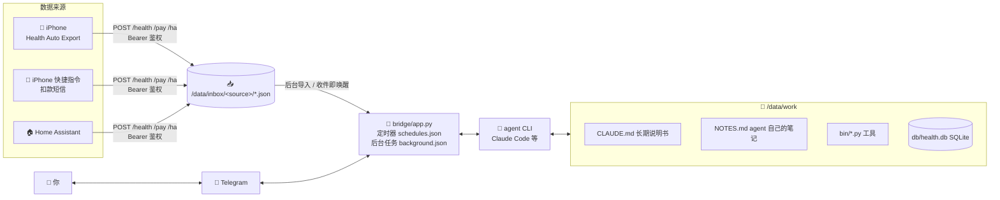

- 整体 = **Claude Code（或任意命令行 agent）+ 一个 200 多行、零依赖的 Python 桥接程序**。没有框架，没有第三方库
- **bridge/app.py**：一个文件、只用 Python 标准库。Telegram 收发、收件口、cron 定时器、收件即唤醒、后台任务都在这里
- **agent**：默认 Claude Code（`claude -p --resume`，自动续上会话）。它读 `CLAUDE.md` 知道自己是谁、该怎么做，自己用 `bin/` 里的工具读写 SQLite；心得写在 `NOTES.md`
- **一切都在 `/data`**：备份这一个文件夹就够了；x86 NAS ↔ ARM VPS 直接拷过去

<details>
<summary><b>📸 作者和自己「又健又富」的 7 个真实故事（数字已改成虚构值，点开看）</b></summary>

**① 从零到通：看截图，手把手带着设置**

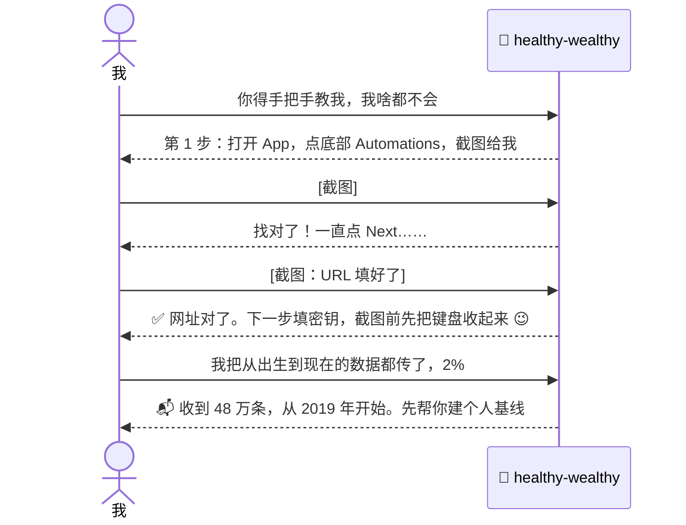

**② 一顿午饭：催 → 拍 → 算 → 自动记账**

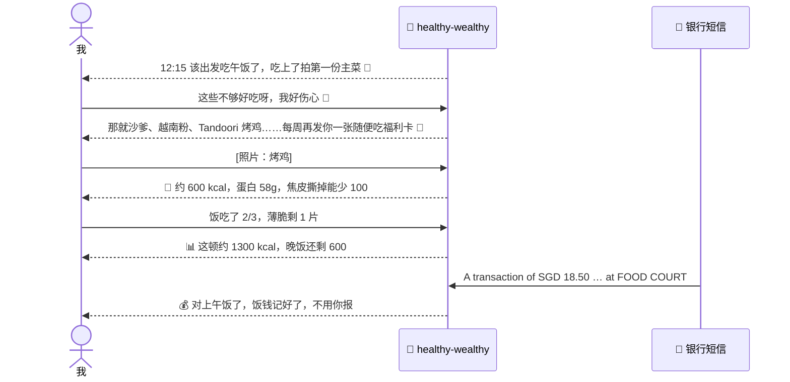

**③ 抓到一杯奶茶（10 秒内）**


**④ 从手表数据里认出你哪几次生病**

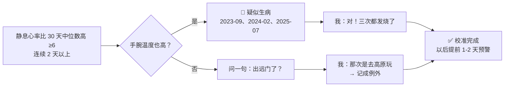

**⑤ 大学四年 vs 毕业后**

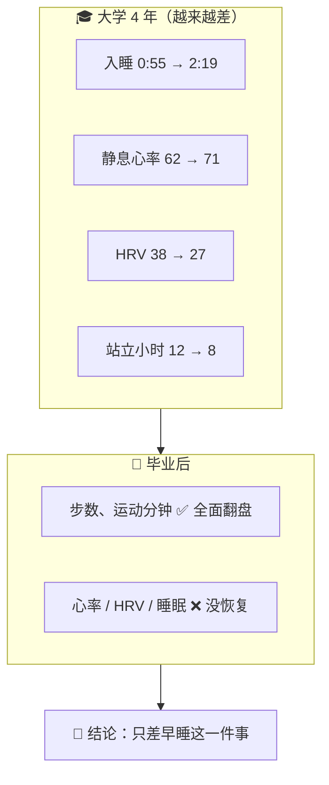

**⑥ 1:30 铁律（主人自己要求的“强制”）**

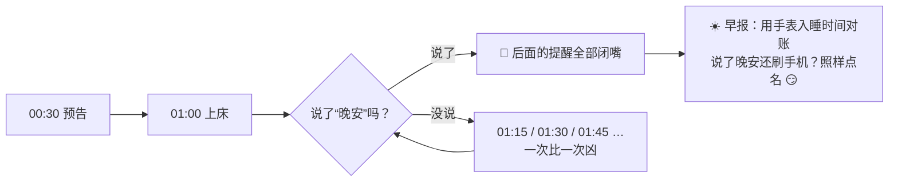

**⑦ 嗓子痒了 10 年 → 家里的传感器给了线索**

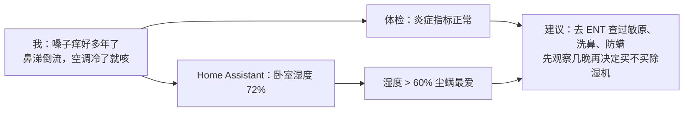

</details>

## 换模型 / 换 agent

bridge 只是调用一个命令行 agent，所以模型和 agent 都能换。

**方式 1：Anthropic 兼容接口（改 3 个环境变量，什么代码都不用动）**

Claude Code 可以接任何兼容 Anthropic Messages API 的服务。在 `.env` 里：

| 模型 | `ANTHROPIC_BASE_URL` | `ANTHROPIC_MODEL` 示例 | 备注 |
|---|---|---|---|
| DeepSeek | `https://api.deepseek.com/anthropic` | `deepseek-chat` / `deepseek-reasoner` | 便宜；**看图能力以官方文档为准**，不能看图时饭照识别会失效，可以改成文字描述 |
| Kimi（Moonshot） | `https://api.moonshot.cn/anthropic` | `kimi-k2-…` | 国内直连 |
| 智谱 GLM | `https://open.bigmodel.cn/api/anthropic` | `glm-4.x` | 有视觉版本 |
| OpenRouter / 自建 LiteLLM | 你的网关地址 | 任意 | 可以接 GPT、Gemini、Qwen、本地 Ollama |

```env
ANTHROPIC_BASE_URL=https://api.deepseek.com/anthropic
ANTHROPIC_AUTH_TOKEN=sk-你的key
ANTHROPIC_MODEL=deepseek-chat
ANTHROPIC_SMALL_FAST_MODEL=deepseek-chat
# 别同时设置 ANTHROPIC_API_KEY
```

> 各家接口地址和模型名会变，以官方文档为准。工具调用、长上下文、看图这三样都要支持，体验才完整。

**方式 2：只有 OpenAI 格式接口？** 在前面放一个转换网关，比如 [LiteLLM](https://github.com/BerriAI/litellm) 或 [claude-code-router](https://github.com/musistudio/claude-code-router)，把 `ANTHROPIC_BASE_URL` 指向它。

**方式 3：换掉整个 agent**（Codex CLI、Gemini CLI、aider，或者你自己写的脚本）
```env
AGENT=cmd
AGENT_CMD=gemini -p "$(cat)"     # prompt 从 stdin 进，回复从 stdout 出
```
- 在 Dockerfile 里把 `npm install -g @anthropic-ai/claude-code` 换成对应 CLI 的安装命令
- 把 `CLAUDE.md` 复制成那个 CLI 读的文件名（Codex：`AGENTS.md`；Gemini CLI：`GEMINI.md`）
- 要求：能在 `/data/work` 里执行 shell 命令（不然用不了 `bin/` 工具），最好能自己记住会话
- 想要多轮记忆：在 `bridge/app.py` 里仿照 `run_claude()` 写一个带会话 ID 的函数

## 可替换的部分

| 组件 | 默认 | 可以换成 |
|---|---|---|
| 聊天 | Telegram | 改 `bridge/app.py` 的 `send_text` / `telegram_loop`：飞书、Discord、Slack、企业微信机器人，或者 Matrix |
| 手机健康数据 | Health Auto Export | Android：Health Connect + Tasker / HC Webhook 类 App，POST 到 `/health`（需要改 `ingest.py` 的解析） |
| 扣款通知 | iOS 快捷指令转短信 | Android：Tasker / MacroDroid 转发短信或通知；银行邮件提醒 → 邮件规则转发 |
| 家居 | Home Assistant | 任何有 HTTP API 的平台，照着 `bin/ha.py` 写一个小工具 |
| 内网穿透 | Tailscale | WireGuard、ZeroTier、Cloudflare Tunnel（记得加 HTTPS） |
| 数据库 | SQLite | 够用了。真要换，改 `bin/` 里的几个脚本 |

## ⚠️ 免责声明

healthy-wealthy **不是医疗器械，也不提供医疗建议**。它给出的热量是估算，健康提醒只是参考。身体不舒服请去看医生。

## License

MIT
